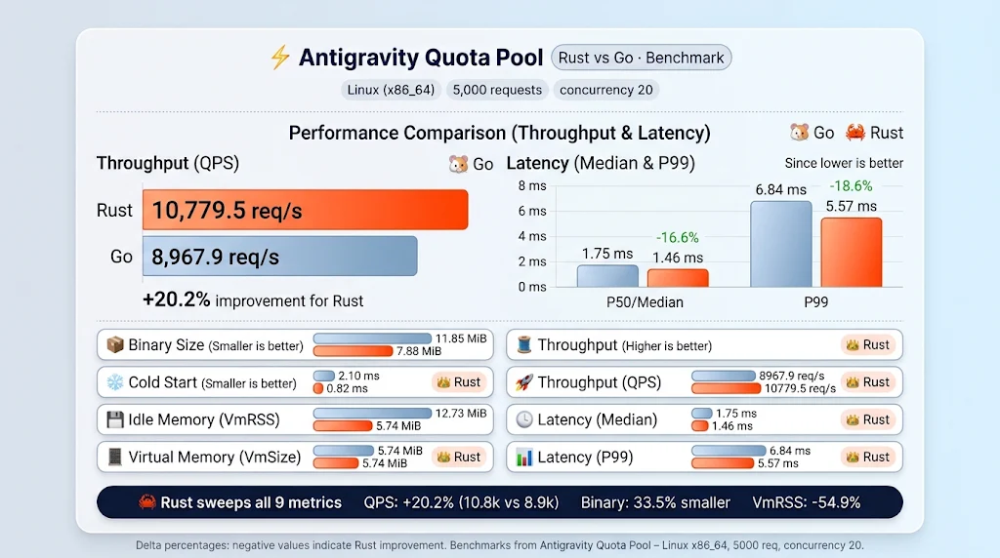

# agy-pool-rust

[](https://github.com/vlxlv/agy-pool-rust/actions/workflows/ci.yml)
[](#)

A local gateway that pools several Google accounts behind the **Antigravity CLI (`agy`)**. `agy` talks to `127.0.0.1:8899`; agy-pool forwards each request upstream on the account with the most usable quota and moves on to the next account when one runs out.

Originally inspired by [midori01/agy-pool](https://github.com/midori01/agy-pool), this is the Rust rewrite of [agy-pool-go](https://github.com/vlxlv/agy-pool-go) and a drop-in replacement for it: same `state.db`, `config.json`, environment variables, command line and port. Replacing the binary is the whole migration, and putting the Go binary back is the whole rollback (see [Migrating from agy-pool-go](#migrating-from-agy-pool-go)). Known behaviour differences are listed in [`PORTING_NOTES.md`](PORTING_NOTES.md).

Release binaries and `.deb` packages are on the [releases page](https://github.com/vlxlv/agy-pool-rust/releases) from v0.2.0 on, and `agy-pool update` installs them. agy-pool-go installs keep updating from agy-pool-go until you switch them over (see [Migrating from agy-pool-go](#migrating-from-agy-pool-go)).

## Features

- **Quota-aware routing.** The `smart` strategy (default) prefers accounts whose quota renews soonest and keeps a low-quota reserve for last; `max_quota` always picks the account with the most remaining quota.
- **Automatic failover.** On HTTP 429 or exhausted quota the request moves to the next account, honouring upstream `Retry-After` and reset times. Model capacity errors (503) pause only that model, not the account.
- **No duplicate generations.** A generation request is retried on another account only if it failed before any byte reached upstream (DNS, connect, TLS). Once a request may have reached Google, it is never replayed.
- **Prompt-cache affinity.** A conversation stays on the same account while that account is healthy, so upstream prompt caching keeps working.
- **Streaming.** Server-sent events are passed through as they arrive.
- **Dashboards.** `quota` shows per-account quota bars and reset times, `top` is a live terminal dashboard, `stats` and `forecast` report routing effectiveness and quota runway.
- **Static release binaries** for Linux (amd64, arm64; musl, so they also run on Termux and old glibc), plus `.deb` packages with systemd units.
- **Encrypted backups.** `export` / `import` move the account pool between machines, optionally encrypted (PBKDF2-HMAC-SHA256).

## Performance Benchmark (Rust vs. Go)

Automated side-by-side benchmark comparing `agy-pool-rust` and `agy-pool-go` under high concurrency (5,000 requests, concurrency = 20) on Ubuntu Linux (`x86_64`):

<p align="center">
  
</p>

| Metric | 🐹 Go | 🦀 Rust | Δ (Rust vs Go) | Winner |
| :--- | :---: | :---: | :---: | :---: |
| **Binary Size** | 11.85 MiB | 7.88 MiB | **-33.5%** | 🦀 Rust |
| **Cold Start (Median)** | 2.10 ms | 0.82 ms | **-60.9%** | 🦀 Rust |
| **Idle Memory (VmRSS)** | 12.73 MiB | 5.74 MiB | **-54.9%** | 🦀 Rust |
| **Virtual Memory (VmSize)** | 1,242.7 MiB | 20.8 MiB | **-98.3%** | 🦀 Rust |
| **OS Threads** | 8 threads | 7 threads | **-12.5%** | 🦀 Rust |
| **Throughput (QPS)** | 8,967.9 req/s | 10,779.5 req/s | **+20.2%** | 🦀 Rust |
| **Latency (Median / P50)** | 1.75 ms | 1.46 ms | **-16.6%** | 🦀 Rust |
| **Latency (P95)** | 4.87 ms | 4.10 ms | **-15.8%** | 🦀 Rust |
| **Latency (P99)** | 6.84 ms | 5.57 ms | **-18.6%** | 🦀 Rust |

> **Summary:** Rust sweeps all 9 metrics, achieving a **+20.2% increase in QPS**, **~61% faster cold starts**, and using **54.9% less resident memory (VmRSS)** with zero garbage collection overhead.

## Install

### Release binary

Download the binary for your platform from the [releases page](https://github.com/vlxlv/agy-pool-rust/releases) (`agy-pool-linux-amd64`, `agy-pool-linux-arm64`), check it against `SHA256SUMS`, then run `install` as below:

```bash
sha256sum --ignore-missing -c SHA256SUMS
chmod +x agy-pool-linux-amd64
./agy-pool-linux-amd64 install
