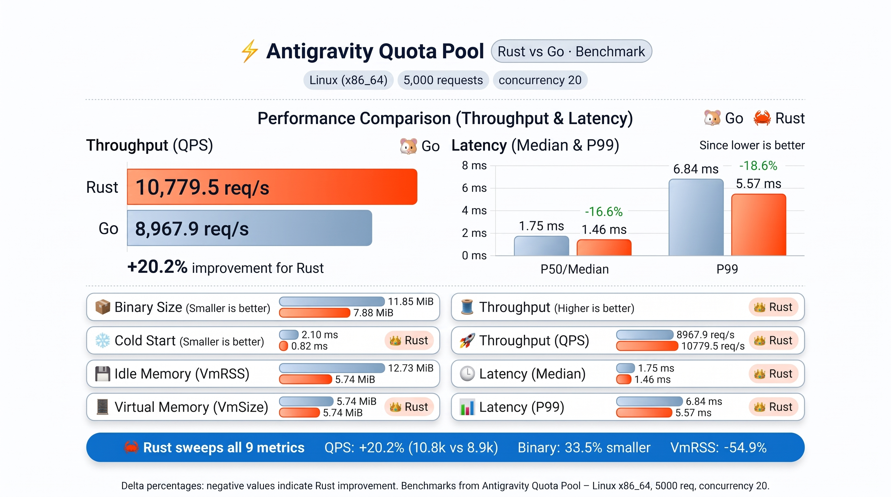

# agy-pool-rust

[](https://github.com/vlxlv/agy-pool-rust/actions/workflows/ci.yml)
[](Cargo.toml)
[](LICENSE)
[](#)

A local gateway that pools several Google accounts behind the **Antigravity CLI (`agy`)**. `agy` talks to `127.0.0.1:8899`; agy-pool forwards each request upstream on the account with the most usable quota and moves on to the next account when one runs out.

Originally inspired by [midori01/agy-pool](https://github.com/midori01/agy-pool), this is the Rust rewrite of [agy-pool-go](https://github.com/vlxlv/agy-pool-go) and a drop-in replacement for it: same `state.db`, `config.json`, environment variables, command line and port. Replacing the binary is the whole migration, and putting the Go binary back is the whole rollback (see [Migrating from agy-pool-go](#migrating-from-agy-pool-go)). Known behaviour differences are listed in [`PORTING_NOTES.md`](PORTING_NOTES.md).

Release binaries and `.deb` packages are on the [releases page](https://github.com/vlxlv/agy-pool-rust/releases) from v0.2.0 on, and `agy-pool update` installs them. agy-pool-go installs keep updating from agy-pool-go until you switch them over (see [Migrating from agy-pool-go](#migrating-from-agy-pool-go)).

## Features

- **Quota-aware routing.** The `smart` strategy (default) prefers accounts whose quota renews soonest and keeps a low-quota reserve for last; `max_quota` always picks the account with the most remaining quota.
- **Automatic failover.** On HTTP 429 or exhausted quota the request moves to the next account, honouring upstream `Retry-After` and reset times. Model capacity errors (503) pause only that model, not the account.
- **No duplicate generations.** A generation request is retried on another account only if it failed before any byte reached upstream (DNS, connect, TLS). Once a request may have reached Google, it is never replayed.
- **Prompt-cache affinity.** A conversation stays on the same account while that account is healthy, so upstream prompt caching keeps working.
- **Streaming & SSE Keep-Alive.** Server-sent events are streamed in real time. Optional keep-alive (`server.keep_alive_secs`, off by default) sends `200` early and then `: keep-alive` heartbeats for slow SSE requests; upstream errors after that point arrive as an in-stream `data: {"error":…}` event instead of an HTTP status.
- **Model Mapping & Aliases.** Configurable `model_mapping` dynamically rewrites model IDs across both URL paths and JSON request bodies.
- **Dual-Track Logging & Structured Audit Events.** Separates operational gateway logs (`agy-pool.log`) from high-resolution, secure request audit events (`audit-events.jsonl`, `0600` permissions) tracking latency, TTFB, token metrics, upstream quota state, and failover reasons (including `ClientDisconnected`). Searchable via `agy-pool logs --audit` (with `-f` to follow).
- **Zero-Downtime Daemon Restart.** `agy-pool restart` seamlessly migrates between different configurations or ports without "port mismatch" errors, dangling PIDs, or manual cleanup.
- **Dashboards.** `quota` shows per-account quota bars and reset times, `top` is a live terminal dashboard, `stats` and `forecast` report routing effectiveness and quota runway.
- **Static release binaries** for Linux (amd64, arm64; musl, so they also run on Termux and old glibc), plus `.deb` packages with systemd units.
- **Encrypted backups.** `export` / `import` move the account pool between machines, optionally encrypted (PBKDF2-HMAC-SHA256).

## Performance Benchmark (Rust vs. Go)

Automated side-by-side benchmark comparing `agy-pool-rust` and `agy-pool-go` under high concurrency (5,000 requests, concurrency = 20) on Ubuntu Linux (`x86_64`):

<p align="center">
  
</p>

| Metric | Go Implementation (`v0.1.1-alpha.2`) | Rust Implementation (`v0.3.1`) | Delta (Rust vs Go) | Winner |
| :--- | :---: | :---: | :---: | :---: |
| **Binary Size** | 11.85 MiB | **7.88 MiB** | **-33.5%** | 🦀 Rust |
| **Cold Start (Median)** | 2.10 ms | **0.82 ms** | **-60.9%** | 🦀 Rust |
| **Idle Memory (VmRSS)** | 12.73 MiB | **5.74 MiB** | **-54.9%** | 🦀 Rust |
| **Virtual Memory (VmSize)** | 1,242.7 MiB | **20.8 MiB** | **-98.3%** | 🦀 Rust |
| **OS Threads** | 8 threads | **7 threads** | **-12.5%** | 🦀 Rust |
| **Throughput (QPS)** | 8,967.9 req/s | **10,779.5 req/s** | **+20.2%** | 🦀 Rust |
| **Latency (Median / P50)** | 1.75 ms | **1.46 ms** | **-16.6%** | 🦀 Rust |
| **Latency (P95)** | 4.87 ms | **4.10 ms** | **-15.8%** | 🦀 Rust |
| **Latency (P99)** | 6.84 ms | **5.57 ms** | **-18.6%** | 🦀 Rust |

> **Summary:** Rust sweeps all 9 metrics, achieving a **+20.2% increase in QPS**, **~61% faster cold starts**, and using **54.9% less resident memory (VmRSS)** with zero garbage collection overhead. Measured via the automated [Benchmark Suite](https://github.com/vlxlv/agy-pool-rust/actions/workflows/benchmark.yml) ([`scripts/benchmark-compare.py`](scripts/benchmark-compare.py)).

## Install

### Release binary

Download the binary for your platform from the [releases page](https://github.com/vlxlv/agy-pool-rust/releases) (`agy-pool-linux-amd64`, `agy-pool-linux-arm64`), check it against `SHA256SUMS`, then run `install` as below:

```bash
sha256sum --ignore-missing -c SHA256SUMS
chmod +x agy-pool-linux-amd64
./agy-pool-linux-amd64 install
```

### From source

Requires Rust 1.99 or newer.

```bash
git clone https://github.com/vlxlv/agy-pool-rust.git
cd agy-pool-rust
cargo build --release --locked
./target/release/agy-pool install          # user mode: ~/.local/bin, recommended
sudo ./target/release/agy-pool install --system
```

`install` puts `agy-pool` on your `PATH`, moves the native `agy` binary to `~/.local/libexec/agy-pool/agy-native`, and replaces `~/.local/bin/agy` with a small shim that runs `agy-pool run`. It never overwrites the only copy of native `agy`.

### Debian / Ubuntu package

Download `agy-pool_<version>_<arch>.deb` from the [releases page](https://github.com/vlxlv/agy-pool-rust/releases) and install it:

```bash
sudo dpkg -i agy-pool_<version>_amd64.deb
systemctl --user enable --now agy-pool     # per user
# or system-wide, as the agy-pool system user (state in /var/lib/agy-pool, config in /etc/agy-pool/config.json):
sudo systemctl enable --now agy-pool
```

Upgrade by installing a newer `.deb`; `agy-pool update` refuses to replace a package-owned binary.

### systemd without the package

```bash
cp contrib/systemd/user/agy-pool.service ~/.config/systemd/user/
systemctl --user enable --now agy-pool     # runs ~/.local/bin/agy-pool
```

When the gateway runs under one of these units, `agy-pool stop` and `agy-pool restart` go through `systemctl`.

## Quick start

```bash
agy-pool login             # add a Google account (repeat for each account)
agy-pool list              # accounts in the pool
agy-pool start             # start the gateway (agy-pool run also starts it on demand)
agy -p "explain this code" # agy now goes through the pool
agy-pool quota             # remaining quota per account
```

After `install`, plain `agy` goes through the pool with no flags or environment changes. To bypass the pool and run native `agy` with its own credentials, use `agy-raw` (or its alias `agy-orig`).

## Commands

| Command | What it does |
|---|---|
| `login`, `import-current` | Add an account by browser login, or import the account native `agy` is signed in with |
| `list`, `quota`, `top` | Show the pool, quota bars, or a live dashboard (`-e` shows emails) |
| `status`, `stats`, `forecast` | Gateway process summary, routing effectiveness, quota runway |
| `start`, `stop`, `restart`, `logs` | Control the gateway daemon, hot-restart across port/config changes, and inspect logs (`--audit` to view structured audit events, `-f` to follow) |
| `run [-- agy args]` | Start the gateway if needed and run native `agy` through it |
| `strategy`, `switch` | Choose the routing strategy, or the account native `agy` uses directly |
| `rename`, `enable`, `disable`, `remove`, `verify` | Manage single accounts |
| `move`, `swap`, `sort`, `reorder` | Change account order |
| `export`, `import` | Back up and restore the pool |
| `doctor` | Check binaries, gateway, database and connectivity |
| `install`, `uninstall`, `update` | Manage the installation |

`agy-pool --help` lists every command with examples.

## Configuration

| Path | Contents |
|---|---|
| `~/.config/agy-pool/config.json` | Static settings: listen address/port, `keep_alive_secs`, `model_mapping` aliases, routing strategy, native `agy` path, log and audit size limits. See [`config.example.json`](config.example.json). |
| `~/.local/share/agy-pool/state.db` | Account pool and runtime state (SQLite). Managed by agy-pool; don't edit it. |
| `~/.local/share/agy-pool/agy-pool.log` | Gateway operational log. Rotates at `logging.max_size_bytes` (5 MB by default). |
| `~/.local/share/agy-pool/audit-events.jsonl` | Structured JSONL request audit stream (`0600` permissions). Rotates at `logging.audit_max_size_bytes` (20 MB by default). |
| `~/.local/share/agy-pool/quota-history.jsonl` | Quota snapshot telemetry history. |

### Configuration Example

```json
{
  "version": 1,
  "server": {
    "listen": "127.0.0.1",
    "port": 8899,
    "keep_alive_secs": 15
  },
  "scheduler": {
    "strategy": "smart"
  },
  "model_mapping": {
    "gemini-2.0-flash-exp": "gemini-2.0-flash"
  },
  "logging": {
    "max_size_bytes": 5242880,
    "backup_count": 1,
    "audit_max_size_bytes": 20971520
  }
}
```

- `server.listen`: Bind address, interface name, or array of addresses/interfaces (e.g. `"127.0.0.1"`, `"tailscale0"`, or `["lo", "tailscale0"]`). Defaults to `"127.0.0.1"`.
- `server.keep_alive_secs`: Interval (seconds) for SSE heartbeat frames (`: keep-alive`). `0` disables keep-alive (default).
- `model_mapping`: Maps requested model names/aliases to target models across URL paths and request payloads.
- `logging.audit_max_size_bytes`: Maximum file size before `audit-events.jsonl` rotates (defaults to 20 MiB).

Environment variables:

| Variable | Effect |
|---|---|
| `AGY_CONFIG_FILE`, `AGY_DATA_DIR` | Use another config file or data directory (same as `-c` / `-D`) |
| `AGY_BIN` | Path of the native `agy` binary to run |
| `AGY_SHOW_EMAIL=1`, `AGY_PRIVACY=0` | Show account emails instead of labels |
| `GH_TOKEN`, `GITHUB_TOKEN` | Optional token for `agy-pool update` (raises GitHub API rate limits) |

## Updating

```bash
agy-pool update --check    # is there a newer release?
agy-pool update            # download, verify against SHA256SUMS, replace, restart the gateway
```

A failed download or checksum mismatch leaves the installed binary untouched. If an official Antigravity update overwrites `~/.local/bin/agy`, `agy-pool doctor` reports it and `agy-pool install` repairs the integration, keeping the new native binary. `agy-pool uninstall` removes the shims, the binary and the managed native copy, and leaves any other `agy` binary alone.

## Migrating from agy-pool-go

State, config and the systemd unit are shared, so only the binary changes. Use a release binary or `target/release/agy-pool` from a source build:

```bash
cp ~/.local/bin/agy-pool ~/.local/bin/agy-pool.go-backup
install -m 755 agy-pool-linux-amd64 ~/.local/bin/agy-pool.new
mv -f ~/.local/bin/agy-pool.new ~/.local/bin/agy-pool
systemctl --user restart agy-pool          # or: agy-pool restart
```

From then on `agy-pool update` follows this repository's releases. Roll back the same way:

```bash
cp ~/.local/bin/agy-pool.go-backup ~/.local/bin/agy-pool
systemctl --user restart agy-pool
```

## Development

Run tests only through the sandbox script, never with bare `cargo test` on a machine where agy-pool is in use:

```bash
scripts/test.sh                                      # cargo test
scripts/test.sh test --lib storage::                 # any cargo arguments
scripts/test.sh clippy --all-targets -- -D warnings
```

`scripts/test.sh` runs cargo in a user, mount and PID namespace in which the real state (`~/.local/share/agy-pool`, `~/.config/agy-pool`, `~/.gemini`, `~/.local/bin`, `~/.local/libexec/agy-pool`, shell rc files) is read-only, the running gateway is invisible, and `systemctl` is stubbed out. It refuses to run if any of that does not hold.

CI ([`ci.yml`](.github/workflows/ci.yml)) runs `cargo fmt --check`, `cargo clippy -D warnings`, the test suite, a concurrency race stress job, and dependency security audit (`rustsec/audit-check`) on every push to `main` and pull request, plus weekly on schedule.

### Releasing

Bump `version` in `Cargo.toml` (and `Cargo.lock`) in the change commit, wait for CI on `main`, then tag that commit `v<version>` (e.g. `v0.2.2`) and push the tag. [`release.yml`](.github/workflows/release.yml) triggers only on `v*` tags, verifies that the tag matches `Cargo.toml`, gates on the test suite and security audit before starting builds, packages and verifies all assets, and publishes the GitHub release titled with the version number (without leading `v`).

## Acknowledgments

Originally inspired by [midori01/agy-pool](https://github.com/midori01/agy-pool).

## License

MIT
